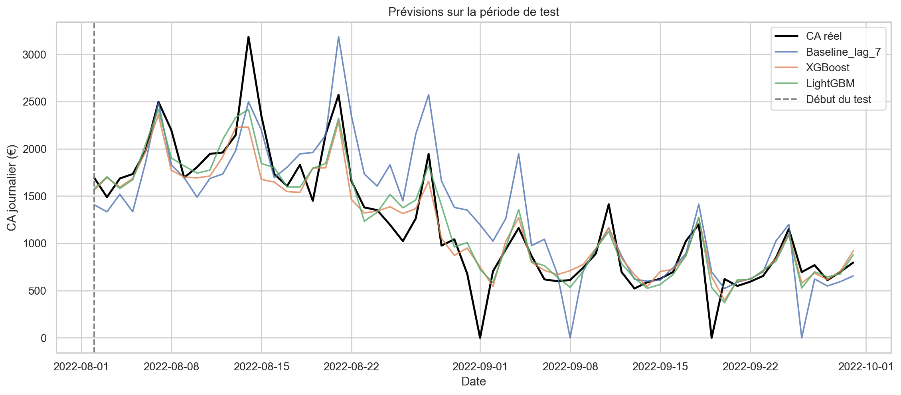
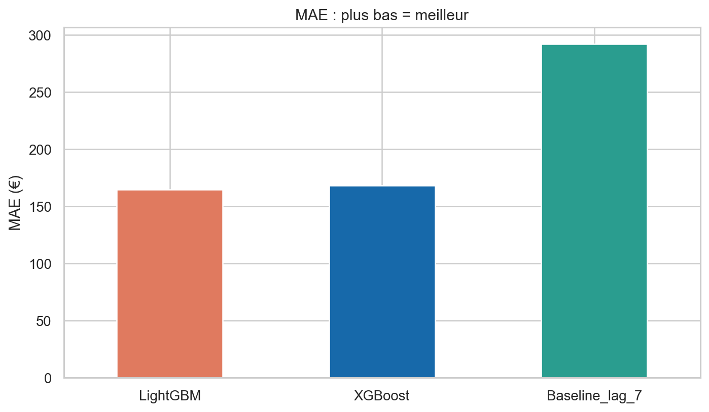
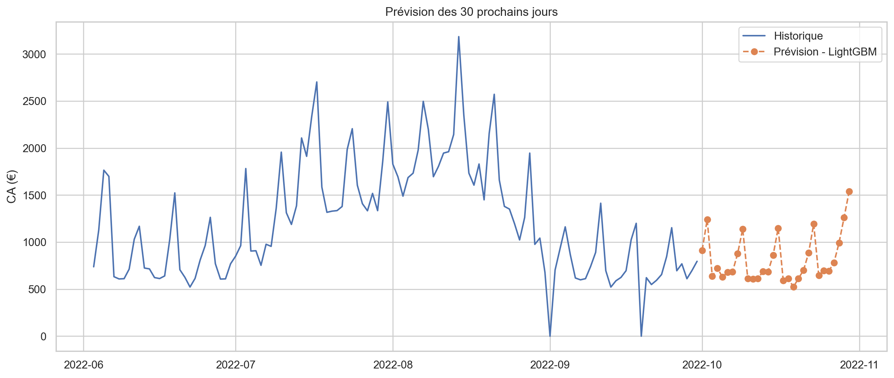

# Prévision des ventes d'une boulangerie

Projet reproductible de prévision des ventes journalières d'une boulangerie. Le notebook nettoie le fichier de transactions, crée un calendrier journalier complet, construit des variables temporelles causales, compare une baseline à XGBoost et LightGBM, puis exporte les graphiques, les tableaux d'évaluation et une prévision sur 30 jours.

> **À propos des données :** le classeur fourni couvre la période du 2 janvier 2021 au 30 septembre 2022. Les prévisions générées commencent donc le 1er octobre 2022. Elles illustrent le fonctionnement du pipeline et ne constituent pas une prévision actuelle.

## Résultats

Le test chronologique porte sur les 60 derniers jours, du 2 août au 30 septembre 2022. Les modèles sont entraînés uniquement sur les dates antérieures. Plus l'erreur est faible, meilleur est le résultat.

| Modèle | MAE (€/jour) | RMSE (€/jour) |
| --- | ---: | ---: |
| LightGBM | 164,68 | 231,23 |
| XGBoost | 168,16 | 251,68 |
| Baseline saisonnière naïve (lag 7) | 292,02 | 396,17 |

Une vérification walk-forward sur trois fenêtres donne un MAE/RMSE moyen de **125,14 / 179,24 €/jour** pour LightGBM et **138,48 / 194,10 €/jour** pour XGBoost. Les résultats détaillés par fenêtre se trouvent dans `outputs/exports/backtesting_walk_forward.xlsx`.

Ces résultats proviennent d'un historique limité et ne garantissent pas les performances en production. En particulier, les 37 dates absentes du fichier source sont traitées comme des jours sans ventes. Cette hypothèse doit être vérifiée à partir des horaires d'ouverture et de la complétude des données.

## Visualisations

**Ventes réelles et prédites sur la période de test**



**Comparaison des modèles selon le MAE**



**Historique et prévision sur 30 jours**



## Étapes du pipeline

1. Charger et nettoyer les transactions du fichier `data/Bakery sales.xlsx`.
2. Calculer le montant de chaque ligne et agréger le chiffre d'affaires, les quantités vendues et les tickets uniques par jour.
3. Compléter le calendrier quotidien, conserver l'indicateur `jour_observe` et, selon l'hypothèse indiquée, remplacer les ventes et comptages manquants par zéro.
4. Créer les variables calendaires, les retards de 1, 7, 14 et 30 jours et les moyennes mobiles de 7, 14 et 30 jours. Les moyennes sont décalées d'un jour afin de ne pas utiliser le chiffre d'affaires à prédire.
5. Comparer une baseline `lag_7`, XGBoost et LightGBM sur la même période de test chronologique de 60 jours, avec le MAE et le RMSE.
6. Effectuer trois fenêtres de validation walk-forward à horizon de 30 jours.
7. Réentraîner le modèle retenu sur tout l'historique disponible et prévoir récursivement les 30 jours suivants.

## Exécution

Prérequis : Python 3.10 ou supérieur.

```bash
python -m venv .venv
```

Dans PowerShell sous Windows :

```powershell
.venv\Scripts\Activate.ps1
pip install -r requirements.txt
```

Ouvrir `notebooks/bakery_sales_forecasting.ipynb`, sélectionner le kernel Python de `.venv`, puis exécuter toutes les cellules. Le classeur source se trouve dans `data/`. Les fichiers Excel et les graphiques PNG générés sont enregistrés dans `outputs/exports/` et `outputs/plots/`.

## Structure du dépôt

```text
bakery-sales-forecast/
├── data/
│   └── Bakery sales.xlsx
├── notebooks/
│   └── bakery_sales_forecasting.ipynb
├── outputs/
│   ├── exports/
│   └── plots/
├── requirements.txt
└── README.md
```


## Limites et pistes d'amélioration

* **Historique limité :** environ 21 mois de données, ce qui limite l'analyse d'une saisonnalité annuelle complète.
* **Données calendaires :** certaines dates absentes sont actuellement considérées comme des jours sans ventes ; cette hypothèse devrait être vérifiée avec les horaires d'ouverture et la qualité des données sources.
* **Variables externes :** les jours fériés et facteurs externes (promotions, météo, ruptures de stock) ne sont pas pris en compte, car les données disponibles ne les renseignent pas. Leur intégration pourrait améliorer les prévisions.
* **Validation :** un backtesting plus étendu et un réglage plus approfondi des hyperparamètres permettraient de renforcer l'évaluation.
